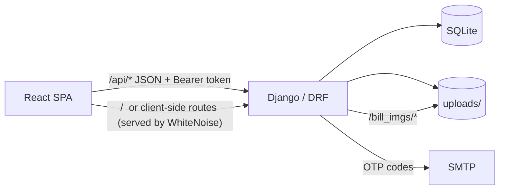

# Architecture

LedgerFlow is a single-container web application: a React SPA, a Django REST API, one SQLite database, and a directory of uploaded bill PDFs. There is no separate web server, cache, or message queue. See [README.md](../README.md) and [api.md](api.md).

## Components

| Component | Role |
| --- | --- |
| `frontend/` (React 19, Vite, React Router 7) | Single-page app: `src/api/*` fetch client, `src/pages/*` one page per area |
| `jbb_projects/` | Settings, root URL conf, SPA/media views, DRF exception handler |
| `accountancy/` | The application: models, `api/` (viewsets, serializers, filters, tenancy), `auth_*` + `otp.py` |
| SQLite (`DJANGO_DATA_DIR/db.sqlite3`) | The only database; `DJANGO_DATA_DIR/uploads` holds bill files |
| Container | Two-stage Dockerfile: Node builds the SPA, then gunicorn + WhiteNoise serve everything |

## Request flow

Every request lands on the one Django process: API views write through the ORM to SQLite, and uploaded bill files land on disk, read back through the authenticated `/api/bills/{id}/file/` endpoint. The production SPA is the built `frontend/dist` collected into Django's static root; a catch-all route serves `index.html` for any non-API path so the client router takes over.

## Main modules

- `accountancy/models.py` — `Business` (one-to-one with the user), `Dealer`, `Bill`, `Payment`, `Cashbook`, `Task`, plus transient `OTPCode`. Financial models carry simple-history audit records.
- `accountancy/api/base.py` — `BusinessScopedViewSet` / `BusinessScopedMixin`: every business-owned row is filtered to, and created under, the caller's business.
- `accountancy/api/views.py` — CRUD viewsets (dealers, bills, payments, tasks) and computed views (business, cashbook, collection-trend, dashboard-summary, bills/purchases).
- `accountancy/auth_*` + `otp.py` — email verification and password reset by 6-digit code; hashed rows, attempt limits, cooldowns.
- `frontend/src/api/*` — one module per endpoint family around a single fetch wrapper that attaches the Bearer token and silently refreshes on 401.

## Key decisions

1. **One container, one process.** The built SPA is served by WhiteNoise and admin by Django, so the deploy is a single gunicorn container — no second service to run or route between.
2. **The tenant is the logged-in user.** Every business-owned row carries a `Business` FK; scoping is enforced in one shared mixin, and foreign keys pointing at another tenant's dealer are rejected with a generic "No such dealer." Clients never send a business id.
3. **JWT with a cookie refresh.** The access token (1 h) lives in `localStorage`; the refresh token (7 d) is an HttpOnly cookie, rotated and blacklisted on use. Login is email-only and email verification is mandatory, via a code instead of a link (`otp.py`).

Deployment specifics (domain, SMTP provider, data volume) are set with environment variables at deploy time and are not fixed in the repository.
